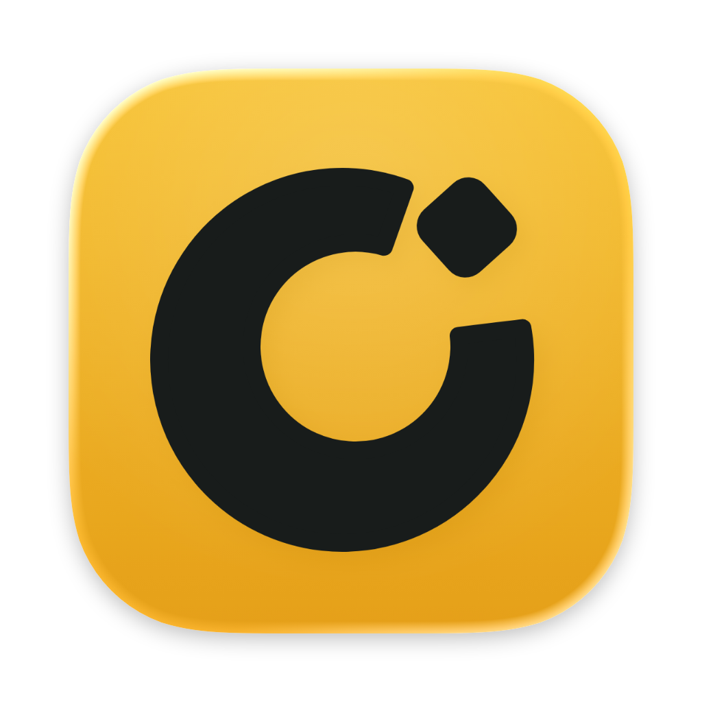
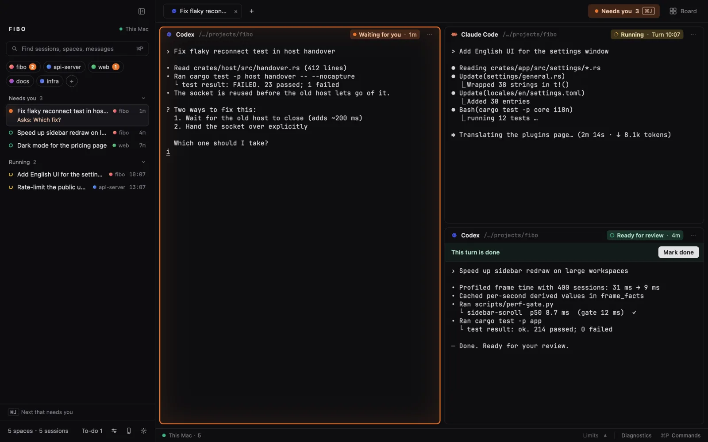
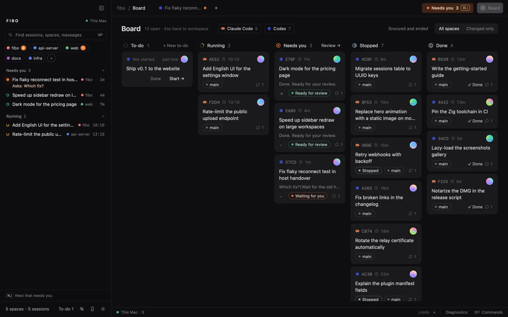

<div align="center">



# Fibo

### Coding agents multiply. Fibo keeps every one running, in sight, and never lost.

**A native macOS workbench for coding agents. Every session is a real terminal; Fibo shows which one needs you, keeps them running when the window closes, and brings back the conversation after a crash.**

[](https://github.com/majiayu000/fibo/releases/latest)
[](https://github.com/majiayu000/fibo/actions/workflows/ci.yml)
[](https://github.com/majiayu000/fibo/commits/main)
[](https://github.com/majiayu000/fibo/pulse)
[](LICENSE)

[](https://github.com/majiayu000/fibo/releases/latest)
[](https://github.com/majiayu000/homebrew-tap)
[](rust-toolchain.toml)
[](https://github.com/zed-industries/zed/tree/main/crates/gpui)
[](https://github.com/ghostty-org/ghostty)
[](https://fibo.page)

[](#03--any-agent-cli)
[](#03--any-agent-cli)
[](#03--any-agent-cli)
[](#03--any-agent-cli)
[](#03--any-agent-cli)
[](#03--any-agent-cli)
[](#03--any-agent-cli)
[](#03--any-agent-cli)
[](#03--any-agent-cli)
[](#03--any-agent-cli)

[Website](https://fibo.page) | [Install](#install) | [What it does](#what-it-does) | [FAQ](#faq) | [中文](README_CN.md)



</div>

---

> **Status:** first release, [v0.1.0](https://github.com/majiayu000/fibo/releases/latest): Apple silicon, macOS 14 or later, signed and notarized. Fibo was called Mooring, and before that Keepline, and lived in the `next/` directory of [majiayu000/keepline](https://github.com/majiayu000/keepline), which keeps the previous generation (Bun CLI, web dashboard, Tauri menu bar).

## Install

Download `Fibo-<version>-arm64.dmg` from the [latest release](https://github.com/majiayu000/fibo/releases/latest) and drag Fibo to Applications, or use Homebrew:

```sh
brew install --cask majiayu000/tap/fibo
```

Open Fibo, run `claude` or `codex` in its terminal, and the session shows up in the sidebar. Releases update themselves (see [How do I update?](#faq)).

### Build from source

You need macOS, Xcode, [Zig](https://ziglang.org/download/) 0.16.x and [rustup](https://rustup.rs) (the Rust version is pinned in `rust-toolchain.toml`).

```sh
git clone https://github.com/majiayu000/fibo.git
cd fibo
./bootstrap.sh            # fetches the pinned GPUI and libghostty sources
DEVELOPER_DIR=/Applications/Xcode.app/Contents/Developer ./run.sh
```

The first build also downloads the Ghostty source and takes a while. Run `claude` or `codex` in a Fibo terminal and the session shows up in the sidebar.

## What it does

### 01 · See which agent needs you

Each session has one state, shown the same way in the sidebar, tabs, panes and the board: **waiting for you** (a question or an approval), **running**, **ready for review** (a turn ended), **done**. A turn ending is not the work being done: only you mark a session complete. The board (鸟瞰) lays every session out in columns, and the status bar shows your Codex, Claude and Grok quota.



### 02 · Close it, they keep working

Terminals live in a background host (`fibo serve`), not in the window. Quit, update or crash the app and every terminal is still there when it opens again. If the host itself goes (a reboot), sessions that were cut off show **resume**: one click reopens the same conversation with `claude --resume` or `codex resume`, with the flags it was started with.

### 03 · Any agent CLI

Claude Code, Codex, Grok Build, Cursor Agent, Qoder CLI, Hermes, Factory Droid, Pi, oh-my-pi, DeepSeek Harness, Kimi Code and Gemini CLI are built in. Fibo reads the session records and events each tool provides; see the [integration boundaries](docs/decisions/2026-11-07-more-agent-inputs.md) for supported formats, child relationships and state signals. Others are added with a JSON plugin (OpenCode ships as an example). Any program can report its own state with one `printf`, using the OSC 7501 status protocol:

```sh
printf '\033]7501;state=working:app=deploy:progress=30\033\\'
```

### 04 · Agents drive Fibo, and each other

Inside a Fibo terminal, an agent can read and drive the others with the `fibo` command. `fibo run` starts another agent with a task; each turn it ends comes back into the caller's input as a `<mooring from=…>` report, so nobody polls.

```sh
fibo list
fibo run codex "review the diff on this branch and list real bugs only"
fibo --skill          # the full guide, written for agents
```

### 05 · Change it with plugins, or ask your agent to

Plugins are plain files in `~/.config/fibo/plugins/`: commands for the pane menu and ⌘P, sidebar layouts, facts on each pane, hooks on state changes (notifications, webhooks), verification rules, the completion animation, new agent CLIs. Ask the agent in your terminal, for example "add a menu item that runs npm test beside this pane". It reads `fibo --skill plugins`, writes the plugin and checks it:

```sh
fibo plugins          # which plugins take effect, and why not
```

## FAQ

**An agent does not show up in the sidebar.**
1. It has to run inside a Fibo terminal; sessions started elsewhere appear on the board only.
2. If it runs behind a wrapper (a sandbox, a VM), start it with `MOORING_AGENT=claude` (or `codex`, …) so Fibo knows what it is.
3. `fibo explain <terminal>` shows how Fibo read that screen; `fibo hooks status` shows whether the agent's hooks are installed and current.

**I used Mooring or Keepline. What changes?**
Nothing to redo. On first start Fibo moves `~/.config/mooring` (or `~/.config/keepline`) to `~/.config/fibo` (a link stays at the old place), keeps using the old runtime directory so the old host hands its terminals over, and still answers to `mooring`, `keepline`, `keeplined`, `MOORING_*` and `KEEPLINE_*`; programs in its terminals also get `FIBO_*`. An app updated in place keeps its folder name (`Mooring.app`); macOS asks once more for notifications, since the app's identifier changed. Run `fibo hooks install` once if Keepline's hook entries are still there.

**What happens when I quit, update or restart?**
Quitting or updating the app leaves every terminal running. Restarting the machine ends them; each interrupted session then offers to resume its conversation in the same directory.

**Where is my data, and does anything leave my machine?**
Terminals and the session index live in `~/.local/share/fibo-workbench`, settings and plugins in `~/.config/fibo`. Fibo reads the agents' own transcripts and never uploads them. The phone relay is opt-in and end-to-end encrypted.

The update check is the only network request the app makes on its own: at most once a day, one `GET` to the GitHub API for the latest release, turned off under Settings › About › Check for updates automatically. The phone relay connects only after you turn it on; everything else that goes online waits for you: fetching the remote plugin catalog, a webhook or an SSH machine you added, a plugin you installed.

**How do I update?**
A release build checks GitHub once a day and shows the new version in the status bar; click it, or use Settings › About › Check for updates. Fibo downloads the release zip, checks it against the release's `SHA256SUMS`, checks that it is signed by Fibo's Developer ID (team `C5UWZ934C2`) and passes Gatekeeper, swaps it in place of the running app and restarts; every terminal keeps running. Nothing is installed if a check fails. Installed with Homebrew: run `brew upgrade --cask fibo`. In a folder you cannot write to (an app owned by root): download it from the release page. A build from source never updates itself; `git pull` and rebuild.

**Does Fibo change my agent settings?**
Only when you install hooks (`fibo hooks install`), which adds Fibo's entries to the agent's settings file; `fibo hooks uninstall` removes them. Without hooks, state comes from transcripts and the screen.

**How do I connect from my phone?**
Fibo on macOS works standalone locally without any server or account. To answer sessions away from your desk, deploy `mooring-relay` ([self-hosting guide](docs/relay/self-host.md)), enter your relay URL under Settings › Phones & Remote, and pair the Expo app in [`mobile/`](mobile/) — traffic is end-to-end encrypted with Noise so the relay never sees plaintext. Official hosted relay is in private beta.

## Repository

- `crates/mooring-app`: the GPUI window. `crates/mooring-host`: the background host and the `fibo` command. `crates/mooring-core`: the shared model and protocol. `crates/mooring-remote`, `mooring-relay`: the phone link and its relay.
- `plugins/`: example plugins. `mobile/`: the phone chat app (Expo). `eval/`: terminal and protocol checks.

Issues: [GitHub Issues](https://github.com/majiayu000/fibo/issues).

<div align="center">

MIT License

</div>

---

## The Agent Infra Stack

This project is one layer of an open-source stack for running coding agents (Claude Code, Codex) as serious infrastructure. Every piece works standalone; together they close the loop:

`fibo` is the **Keep** layer: see which agent needs you, keep sessions alive, and return to the right conversation.

| Layer | Project | What it does |
|---|---|---|
| Extend | [claude-skill-registry](https://github.com/majiayu000/claude-skill-registry) | Discover and search community Claude Code skills |
| Extend | [spellbook](https://github.com/majiayu000/spellbook) | Cross-runtime skills for Claude Code, Codex, and multi-agent workflows |
| Trust | [argus](https://github.com/majiayu000/argus) | Static install-time scanner for supply-chain attacks (npm / PyPI / crates.io) |
| Trust | [vibeguard](https://github.com/majiayu000/vibeguard) | Rules, hooks, and guards against hallucinated or unverified agent changes |
| Remember | [remem](https://github.com/majiayu000/remem) | Local-first persistent memory for Claude Code and Codex sessions |
| Orchestrate | [harness](https://github.com/majiayu000/harness) | Rust agent orchestration platform — rules, skills, GC, observability |
| Route | [litellm-rs](https://github.com/majiayu000/litellm-rs) | High-performance Rust AI gateway — 100+ LLM APIs via OpenAI format |
| Keep | [fibo](https://github.com/majiayu000/fibo) **◀ you are here** | Session command center — monitor, recover, never lose agent work |
