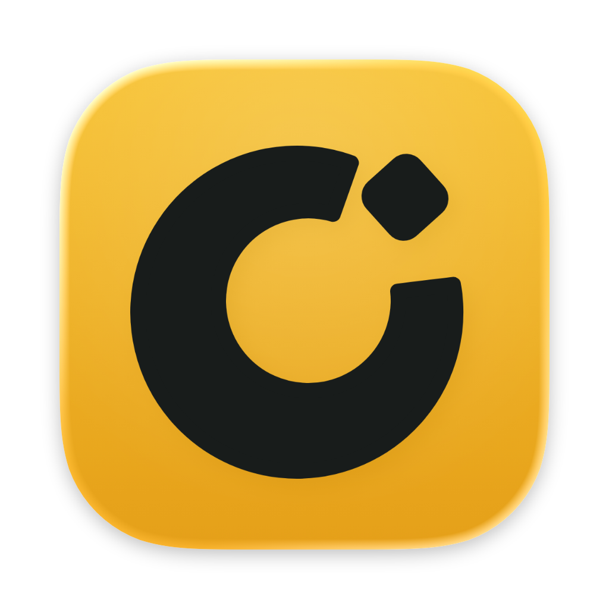
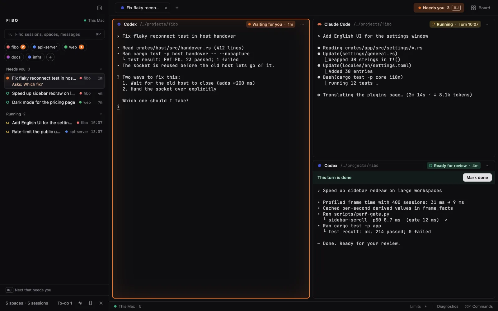
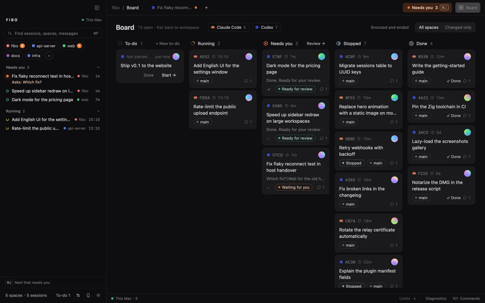

<div align="center">



# Fibo

### Coding Agent 一个接一个冒出来，Fibo 让每一个都在跑、看得见、丢不了。

**给 Coding Agent 用的原生 macOS 工作台。每个会话都是一个真终端；Fibo 告诉你哪个在等你，关掉窗口它们照样跑，崩了也能接着聊。**

[](https://github.com/majiayu000/mooring)
[](LICENSE)
[](https://github.com/majiayu000/mooring/releases/latest)
[](https://github.com/majiayu000/mooring/actions/workflows/ci.yml)
[](https://github.com/majiayu000/mooring/releases/latest)
[](https://github.com/majiayu000/homebrew-tap)

[官网](https://fibo.page) | [安装](#安装) | [能做什么](#能做什么) | [常见问题](#常见问题) | [English](README.md)



</div>

---

> **现状：** 第一个发布版 [v0.1.0](https://github.com/majiayu000/mooring/releases/latest)：Apple 芯片，macOS 14 及以上，已签名并经 Apple 公证。Fibo 原名 Mooring，更早叫 Keepline，之前放在 [majiayu000/keepline](https://github.com/majiayu000/keepline) 的 `next/` 目录里；那个仓库保留上一代（Bun 命令行、网页仪表盘、Tauri 菜单栏）。

## 安装

从[最新发布](https://github.com/majiayu000/mooring/releases/latest)下载 `Fibo-<版本>-arm64.dmg`，把 Fibo 拖进「应用程序」；或者用 Homebrew：

```sh
brew install --cask majiayu000/tap/fibo
```

打开 Fibo，在它的终端里运行 `claude` 或 `codex`，会话就会出现在左栏。发布版会自己更新（见[常见问题](#常见问题)里的「怎么更新」）。

### 从源码构建

需要 macOS、Xcode、[Zig](https://ziglang.org/download/) 0.16.x 和 [rustup](https://rustup.rs)（Rust 版本固定在 `rust-toolchain.toml`）。

```sh
git clone https://github.com/majiayu000/mooring.git
cd mooring
./bootstrap.sh            # 拉取固定版本的 GPUI 和 libghostty 源码
DEVELOPER_DIR=/Applications/Xcode.app/Contents/Developer ./run.sh
```

第一次构建还会下载 Ghostty 源码，要等一会儿。在 Fibo 的终端里运行 `claude` 或 `codex`，会话就会出现在左栏。

## 能做什么

### 01 · 一眼看出哪个 Agent 在等你

每个会话只有一个状态，左栏、标签、窗格和看板上的说法一致：**等你回答**（提问或审批）、**在跑**、**等你验收**（一轮跑完）、**做完了**。一轮跑完不等于活干完了，只有你点了标记完成才算做完。鸟瞰把所有会话按列摊开，底栏显示 Codex、Claude、Grok 的额度。



### 02 · 关掉窗口，它们照样跑

终端跑在后台进程（`fibo serve`）里，不在窗口里。退出、更新或 App 崩溃，再打开时终端都还在。连后台也没了（比如重启电脑）时，被打断的会话会显示**接着聊**：点一下就用 `claude --resume` 或 `codex resume` 回到同一段对话，启动时带的参数也一起带上。

### 03 · 什么 Agent 都能接

内置 Claude Code、Codex、Grok Build、Cursor Agent、Qoder CLI，以及 Hermes、Factory Droid、Pi、oh-my-pi、DeepSeek Harness、Kimi Code、Gemini CLI。Fibo 读取各工具提供的会话记录和事件；各新增工具的父子关系、格式和状态边界见[接入说明](docs/decisions/2026-11-07-more-agent-inputs.md)。别的 CLI 用一个 JSON 插件接入（自带 OpenCode 示例）。任何程序都能用 OSC 7501 状态协议，一行 `printf` 报告自己的状态：

```sh
printf '\033]7501;state=working:app=deploy:progress=30\033\\'
```

### 04 · Agent 能驱动 Fibo，也能互相派活

在 Fibo 终端里，Agent 可以用 `fibo` 命令读别的终端、给别的 Agent 发话。`fibo run` 派另一个 Agent 去做一件事；它每结束一轮，结果会以 `<mooring from=…>` 自动回到派活那一方的输入框，谁都不用轮询。

```sh
fibo list
fibo run codex "审一下这个分支的改动，只列真正的 bug"
fibo --skill          # 写给 Agent 看的完整说明
```

### 05 · 用插件改它，或者让 Agent 替你改

插件就是 `~/.config/fibo/plugins/` 下的普通文件：右键菜单和 ⌘P 里的命令、左栏排法、窗格上显示的信息、状态变化时的 hook（通知、webhook）、验证规则、完成动画、新的 Agent CLI。直接跟终端里的 Agent 说，比如「加一个右键命令，在旁边跑 npm test」，它会读 `fibo --skill plugins`，写好插件并检查：

```sh
fibo plugins          # 哪些插件生效了，没生效的为什么
```

## 常见问题

**Agent 没出现在左栏。**
1. 要在 Fibo 的终端里运行；在别处启动的会话只在看板上以「外部·只读」出现。
2. 套在包装器（沙盒、虚拟机）里运行时，启动前设 `MOORING_AGENT=claude`（或 `codex` 等），让 Fibo 认得它。
3. `fibo explain <终端>` 看 Fibo 怎么读这块屏；`fibo hooks status` 看 Agent 的 hook 装了没有、是不是最新。

**以前用的是 Mooring 或 Keepline，要做什么？**
不用重来。Fibo 第一次启动时会把 `~/.config/mooring`（或 `~/.config/keepline`）搬到 `~/.config/fibo`（原位置留一个链接），继续用旧的运行目录，让老后台把终端交接过来；`mooring`、`keepline`、`keeplined` 命令和 `MOORING_*`、`KEEPLINE_*` 变量也照样认，终端里的程序另外还能读到 `FIBO_*`。原地更新的 App 文件夹名不变（还叫 `Mooring.app`）；App 的标识换了，macOS 会再问一次通知权限。Keepline 的 hook 条目还在的话，运行一次 `fibo hooks install`。

**退出、更新或重启会怎样？**
退出或更新 App，终端都继续跑。重启电脑会结束它们，被打断的会话会提示在原目录接着聊。

**数据放在哪，会不会传出去？**
终端和会话索引在 `~/.local/share/fibo-workbench`，设置和插件在 `~/.config/fibo`。Fibo 只读 Agent 自己的对话记录，不上传。手机中继要你自己开启，内容端到端加密。

检查更新是 App 唯一会自己发出的网络请求：每天最多一次，向 GitHub API 要一次最新发布的信息；在「设置 › 关于 › 自动检查更新」里关掉。手机中继要你开启后才连；其余联网都等你动手：获取远程插件目录、你加的 webhook 和 SSH 电脑、你装的插件。

**怎么更新？**
发布版每天向 GitHub 查一次，有新版本时状态栏会显示，点它或在「设置 › 关于 › 检查更新」里更新。Fibo 下载发布的 zip，按发布里的 `SHA256SUMS` 校验，确认是 Fibo 的 Developer ID（团队 `C5UWZ934C2`）签名并通过 Gatekeeper，再把它换到正在运行的 App 的位置并重启；终端都继续运行。任何一项校验不通过都不会安装。用 Homebrew 装的请运行 `brew upgrade --cask fibo`；App 所在的文件夹没有写权限（比如 App 属于 root）时请从发布页下载。从源码运行的版本不自动更新，`git pull` 后重新构建。

**Fibo 会改我的 Agent 配置吗？**
只有安装 hook（`fibo hooks install`）时会在 Agent 的配置文件里加上 Fibo 的条目，`fibo hooks uninstall` 会移除。不装 hook 时，状态从对话记录和画面读。

## 仓库结构

- `crates/mooring-app` 是 GPUI 窗口，`crates/mooring-host` 是后台和 `fibo` 命令，`crates/mooring-core` 是共用的模型和协议，`crates/mooring-remote`、`mooring-relay` 是手机连接和中继。
- `plugins/` 是示例插件，`mobile/` 是手机聊天 App（Expo），`eval/` 是终端和协议的检查工具。

问题反馈：[GitHub Issues](https://github.com/majiayu000/mooring/issues)。

<div align="center">

MIT License

</div>
