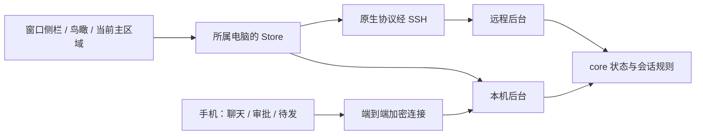

# 下一候选版收尾设计

日期：2026-11-16。基线：`2efacb85`。来源：用户要求“做一个完整的设计，然后来实现，没收尾的”。

## 目标与决定

把已经实现但分散在主线、本地分支和手机 PR 的工作收成一个可复核的候选版。成功标准是同一份源码通过相关回归，并能按 `acceptance.md` 逐项说明真实设备上发生了什么。

采用现有后台、原生 SSH 连接、Workspace、Store、手机请求队列和验收脚本。最小实现是合并已有修复、补真实缺陷、记录组合验证；不新增状态中心、配置层或自动判定“可发布”的规则引擎。

第 2 步“大规模拆数据与界面”继续暂缓。用户随后明确“都要做”，范围扩展到 Windows/Linux 正式交付及 iOS 完整交付。各平台独立验收，不能用 Mac + Android 的通过抵消其他平台缺口。发布、替换用户正在运行的 App、远程部署仍需相应授权。

放弃条件：同一候选版发现阻断错误就停止该轮验收，修复后更换候选版从头走；性能优化在相同夹具下没有可重复收益则撤掉该优化；不通过放宽门禁或用模拟器代替真机来收尾。

## 当前数据与操作路径

事实继续由 core 计算；终端归所属电脑后台持有；窗口关闭、切空间和后台订阅不是用户要求新建终端或接管输入。

## 实现范围与验收

| 工作 | 最小设计 | 完成证据 |
|---|---|---|
| 多机隐藏工作台 | 复用 audit/20261116：区分已连接与正在显示；隐藏工作台只跟工作区，不提前创建窗格、恢复 shell、接管输入或写窗口离开时间；显示时按需准备 | 连接未展示的机器不增加终端、不抢输入；切换、返回、鸟瞰、重连仍正常；现有 hosts evidence 扩展 |
| 侧栏性能 | 复用 perf/idle-cpu-20261116 的 4 个提交：已知行高与更少容器、一次计算标签名、便宜过滤优先、lost_agents 集合查询 | 原有回归、同夹具视觉差异核对、真机指令门禁；基线每项变化有解释 |
| 手机修复 | 复用 #330 的 8 项修复：审批折行识别、会话绑定、工具输出拼接、解绑失败保持连接、面容锁与持久化失败、反馈归属和重复审批互斥 | 手机测试、类型检查、host 回归；真正交付前整张真机清单；不把七项 CI 成功当作真机结论 |
| 设备文件 #128 | 主线已修首次 code / machine-id 并发、更新前读失败保护、旧临时文件清理，先跑已有回归；补持锁进程不释放时的有界失败 | 第二个写者超时且原数据未动；锁释放后可继续；并发配对与撤销仍无丢失 |
| 发行身份与验收 | 沿用 commit、App/CLI/APK 哈希和四种结果；候选版期间不换包、不更新插件 | `acceptance.md` 桌面 17 条、手机整表、安装 6 条，逐项保留证据和未验原因 |
| 待办 #120 | 沿用 Task/ToDo；验证记录→启动→真实 Agent 写回→继续→用户验收 | 进入正确会话、写回实际出现、Agent 结束不自动等于完成；使用效率需要用户试用，不新建清单产品 |

## 多平台交付设计（用户追加范围）

| 平台 | 本轮实现 | 交付门槛与停止条件 |
|---|---|---|
| Windows x64 | 沿用 MSVC + Inno Setup；让涉及产品源码的 PR 也实际打包，保留包哈希和来源；安装、升级、卸载走同一安装器；正式签名使用现有证书，由签名环境提供 | 安装包编译及隔离安装读回；真实桌面开窗、键鼠、Agent 和手机链路；无代码签名不能称为正式签名版，等待证书而不生成假身份 |
| Ubuntu 24.04 x64/ARM64 | 沿用 GPUI X11/Wayland 和现有 host，新增一个 Debian 包脚本与独立工作流；包含窗口、CLI、插件目录、桌面入口和图标，依赖由 ELF 链接关系生成 | 包内容、CLI/隔离 host、终端链路、真实图形会话；容器验证只代表容器，不替代桌面、Secret Service 和通知 |
| iOS | 沿用 Expo 58 页面和模拟器检查；补 EAS 内部分发/商店构建配置、无签名设备 archive 编译入口，保留应用身份；不手改 CNG 生成工程 | 真 iPhone 的整张手机清单、Face ID/系统权限/后台恢复、有效签名与可安装 IPA；缺账号或设备时保存产物和具体缺口，不能把模拟器 ZIP 称 IPA |

最小实现新增四个交付文件（Linux 脚本/工作流、iOS archive 脚本/EAS 配置），修改既有 Windows 与 iOS 工作流。不会引入另一套自动更新器、跨平台状态抽象、凭据保管层或对所有 Linux 发行版的承诺。Windows/Linux 更新先复用各自安装包；Windows 无终端交接的现有差异继续明确提示，不能伪称无损更新。

签名、Apple/Expo 账号、真实设备和发行公开是独立阶段。可以在缺凭据时完成并验证源码、安装布局与无签名 archive；最终签名安装和公开分发仍须真实完成才算交付。

## 错误、旧数据和相邻入口

- 设备文件仍由同一个现有锁串行修改；等待设固定上限，无新配置。超时返回可读错误，不删除锁文件、不踢持锁进程、不写空数据。
- 既有文件继续读；缺文件、坏文件和暂时拿不到锁不能混为一类。保留老临时文件清理与多进程回归。
- 远程断开保留最后状态。主区域显示、隐藏订阅、偷看首次打字三种入口分别验证；本机启动行为不随之改变。
- 手机审批在首页、聊天和审批页共用已有动作入口；反馈绑定当前展示的会话；保存失败不得显示已保存。
- Claude、Codex、OpenCode 分别列验收覆盖。Mac、Android、iOS、Windows、Linux 的证据不得互相替代。

## 施工与集成顺序

1. 在独立 `feat/closeout-20261116` 工作区固定上述来源的快照，不改原性能、审计和手机工作区。
2. 先复用现有实现并记录来源，解决组合冲突；只对仍能证明的缺口写新代码。
3. 跑相关 core/host/手机回归，再编探针版、运行 hosts evidence 与性能门禁；视觉修改核对相同数据下的新旧截图。
4. 通过后记录候选源码与产物哈希。真实手机可用时走全表；离线时全部未走项目记“没验”，保留设备需求。
5. 汇总已验 / 没验 / 相邻情况，更新项目地图。PR、CI、合入、发布与实机验收分开记。

## 影响范围

现有实现涉及 `crates/fibo-app` 的 hosts、pane_sync、sidebar、redraw，`fibo-core` 的标签名、内容摘要，`fibo-host` 的识别、审批与设备文件，`mobile/src` 的动作、存储和页面入口。新增设计与验收记录放 `docs/release/`；运行截图和日志放 `~/Documents/claude-pages/fibo/`。

不引入新的抽象层、协议主版本、文件格式、配置表或依赖。启动上下文工作区目前只有原型，不在缺少用户可见行为设计时直接纳入。

## 开工时的缺口

- Android 最初 Wi-Fi ADB 离线；14:49 已通过 USB 连接 PMA110。新 APK 已构建，正在等待换包验收授权。
- 当前运行 0.1.2 build 1198 不是本轮候选版；不把它的验收记到新源码。
- 干净安装需要新 macOS 用户与公证 DMG；当前没有本轮产物。
- #266 是 Google 后台的独立待办；issue 尚开不证明当前尚未收录。
- Windows 已有预览版，Linux 无发布版；iOS 真机及各平台全链路没有本轮回执。

## 执行记录

产品修复整合提交：`30db38cb`。本轮 `cargo fmt`、workspace clippy、visual-test clippy、`ci-test.sh` 完整通过，未发生重跑。手机 246 项测试及类型检查通过；Expo lint 没有配置，因此不能记为通过。

设备锁测试有真实红绿：旧实现持续等待，6 秒后测试失败；新实现 5 秒返回超时，原字节未变，释放锁后能添加设备。1ms 锁轮询通过重竞争回归；20ms 版本曾发生饥饿，已放弃。

多机探针走通隐藏订阅、远程开标签、返回、切回和鸟瞰。第一次因测试 HOME 太长（socket 126 字节）失败，缩短测试运行目录后通过。退出后没有远程标签、运行中的 shell 或 SSH 转发；Exited 记录属于历史，脚本已改为区分历史与运行进程，并真正传播检查失败。

性能重复测量：整窗 57.73 / 57.50 / 57.78 M（旧基线 106.89 M），展开最终 52.25 M；第三轮完整门禁通过。只收紧 6 项改善指标，没有放宽终端与主题预算。随后 #365 将同一优化和略严的基线合入主线，本分支采用主线基线；第三轮数据仍在该基线预算内。前后两种窗口宽度的截图只差运行计时末位，布局不变。

隐藏工作台的反证也完成：只撤销 embedded 构造时的提前返回，探针真实报错“远程机器尚未选中就创建了 1 个终端”；保留修复时通过。探针的退出检查区分历史 Exited 记录与仍在运行的 shell。

本地 Mac 候选包为 `target/closeout/Fibo.app`，版本 0.1.2/build 1212，Developer ID 已签名，未公证/未发布。Android arm64 测试 APK 已生成（SHA256 `37cb1136b17e5d5d9147503eb5efa95283cd2fe45f43fcd67d959c96fc68cffa`）；未换包前不能将旧手机上的结果归到它。

### 平台验证回执（2026-11-16）

草稿 PR #366 首轮 head `24ee0778` 的 CI、Windows check、Linux check、Windows installer、Linux installer 已通过。Windows Server 2025 runner 实际安装、调用已安装后台得到 `[]`、运行旧 CLI，再卸载确认可执行文件移除。Ubuntu 24.04 的 x64 与 ARM64 实际安装 Debian 包、读回 CLI 版本和空工作区，终端链路完成创建、列出、读屏、打字；需要真实 Agent 的测试明确保持 ignored。

上述产物来自 PR 合并测试提交 `4f27163b`，不是 head 的独立构建。下载后的 ZIP 哈希与 GitHub artifact digest 一致，包清单读回如下：

| 产物 | SHA256 | 边界 |
|---|---|---|
| Windows `Fibo-Setup-0.1.2.exe` | `db5a6419de2f8c7b75327ef3d54822d83a3129e65b5a7bd4478096edf5fb1f6d` | unsigned、未发布，未验桌面交互 |
| Ubuntu amd64 `.deb` | `2f21ad9f0b1c885d3bb5f46473467d1dcac96b043cd7e81e4b1cfed5a276b718` | 安装与后台通过，未验图形桌面 |
| Ubuntu arm64 `.deb` | `c9fd0149c150ff69b4a2bfc81ae856318b3200186a7a9e152da65649bcceb431` | 同上 |

Linux 首轮 manifest 的 dirty 为 true。已确认工作流把 Zig 缓存写在仓库根目录而没有忽略；本轮补入 `.gitignore`，清单同时保留具体状态行，下一轮核对是否还有其他改动。不能把这批清单改写成 clean。

iOS 本地 Release 模拟器包和无签名设备 archive 都已构建。第一次启动截图显示完整配对首页；第二次 5 秒截图是白屏，即使进程存活也不算 UI 通过。进一步诊断遇到 CoreSimulator 安装服务 4097 错误及开机阶段停住，尚不能归因于 App。脚本保存安装/启动失败日志、限制清理等待，并把 simulator App 移到稳定证据目录，避免后续 Expo prebuild 清除它。之后对同一 simulator App 记录两次启动的 5/15/30 秒画面，六张都显示完整配对首页，首启和重启仅系统时钟 1217 像素不同。此前白屏未复现且根因未确认，保留为间歇启动问题，不能声称已修复。设备 archive 没有签名，不能安装到真 iPhone，不能称 IPA 或完整交付。

已验：远程标签实际创建/返回/清理、锁超时保留原文件、性能重复测量及前后截图、Windows 安装后台与卸载、Ubuntu 两架构安装和终端输入；没验：Android 候选全表 30 项、iPhone、桌面 17 项和干净安装 6 项；相邻情况：旧设备文件与竞争写入已有回归，真实 Claude/Codex/OpenCode 手机闭环及 Windows/Linux 图形会话未验。

### 签名环境具备后的交付命令

- iOS：在 `mobile/` 中用 `bunx eas-cli build --platform ios --profile preview` 生成内部真机包；生产签名用 `--profile production`。账号/项目及设备注册使用 EAS 的现有流程，不把凭据写进仓库。构建与提交商店分开执行。
- Windows：先用组织的 `signtool sign /sha1 <证书指纹> /fd SHA256 /tr <证书商时间戳地址> /td SHA256` 签 stage 中的 exe，再用 Inno Setup 的 `/DSignTool=fibo` 与 `/Sfibo="signtool ... $f"` 签安装器和卸载器；`signtool verify /pa /all` 读回。没有现成证书时保持 unsigned，不称正式签名版。
- Linux：原生 Ubuntu runner 构建后执行 `python3 packaging/linux/package.py`，用 `sudo apt install ./target/linux-package/*.deb` 安装/更新。容器不证明桌面可用。

当前决定：采用现有产品收尾和上述三平台交付范围；发行结论待验证。完整日志和截图保留在 `~/Documents/claude-pages/fibo/2026-11-16-closeout/`。
